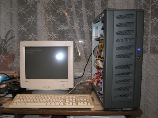
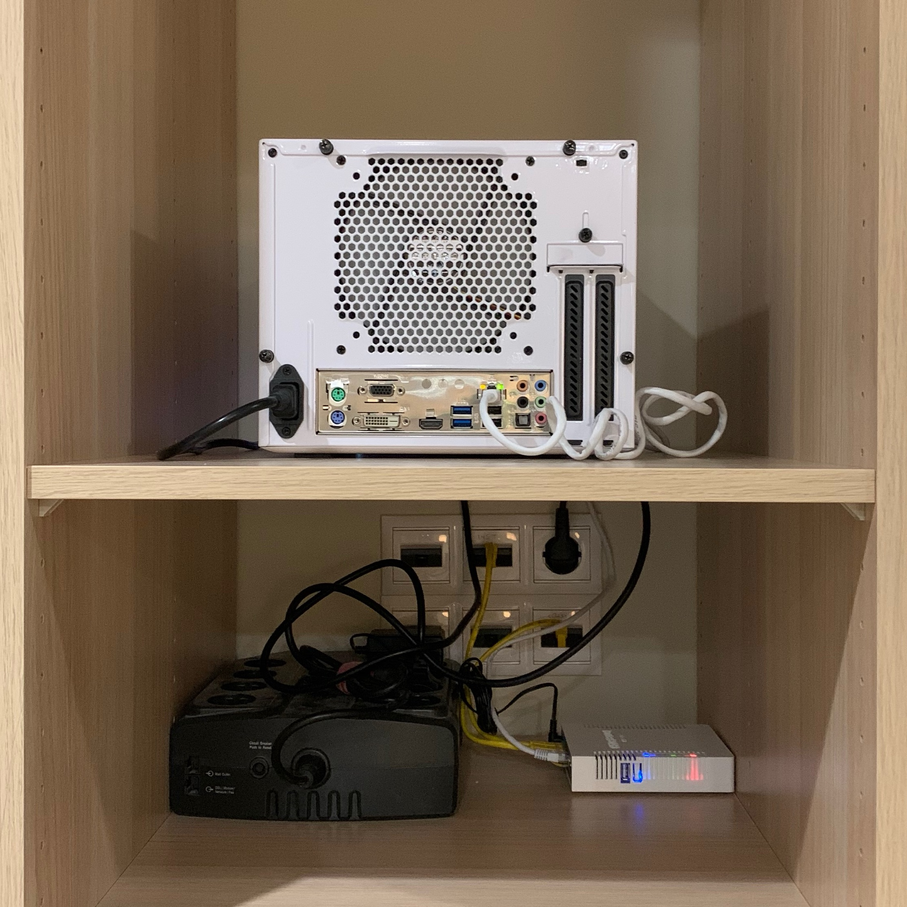
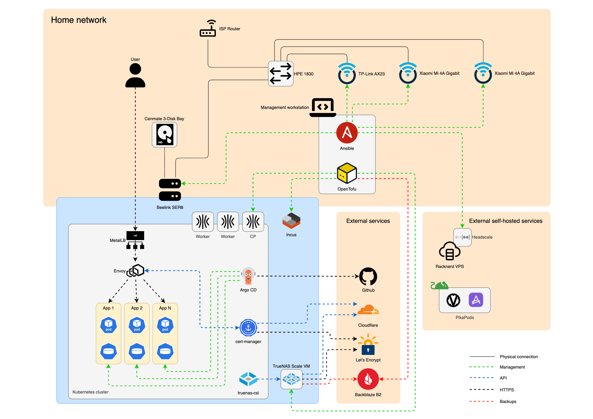
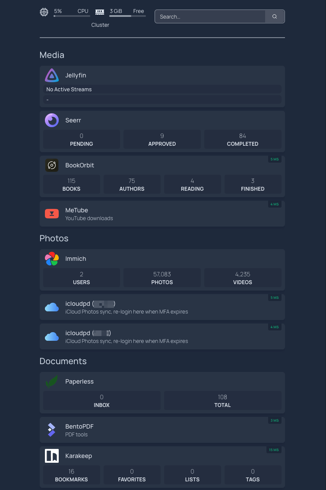
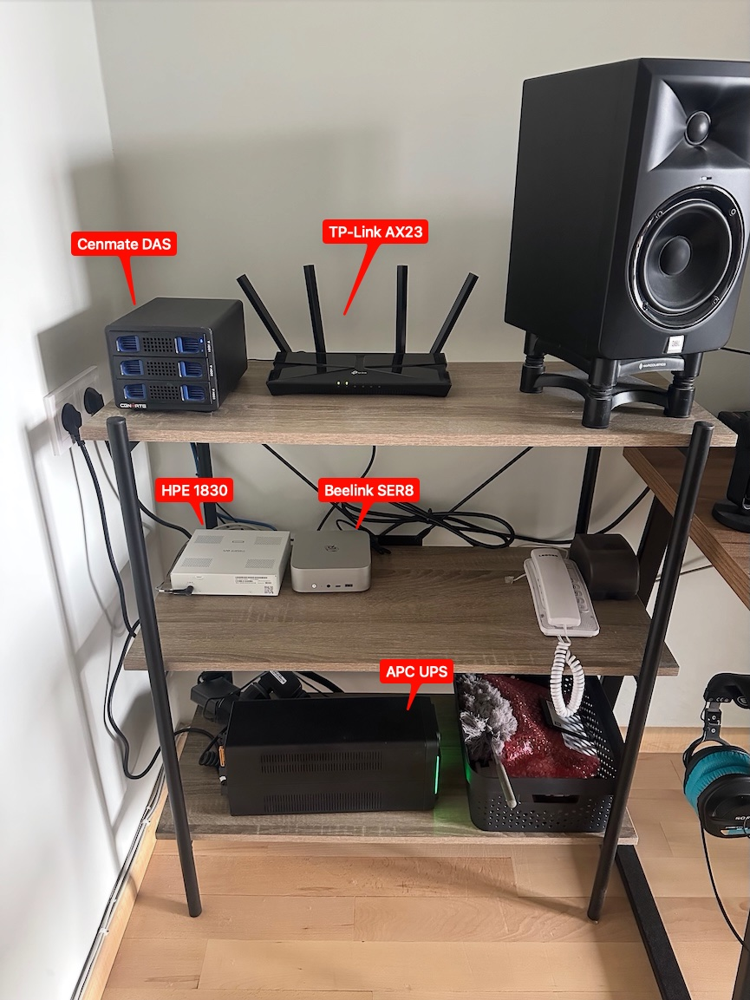
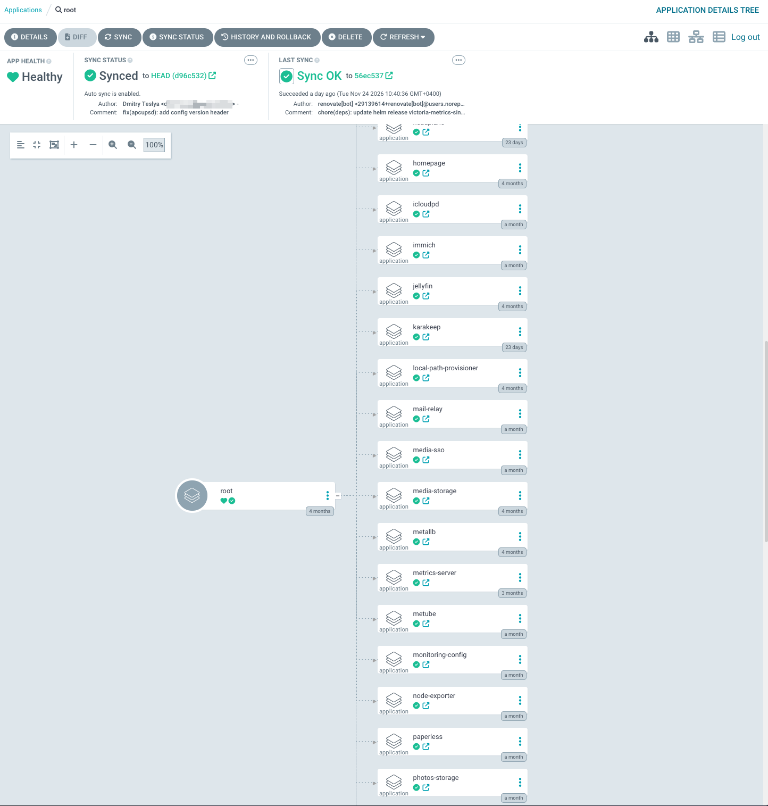
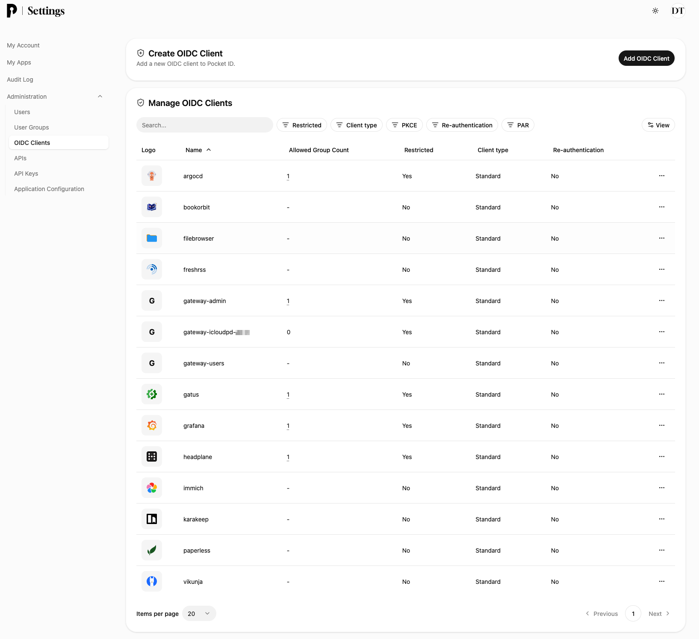
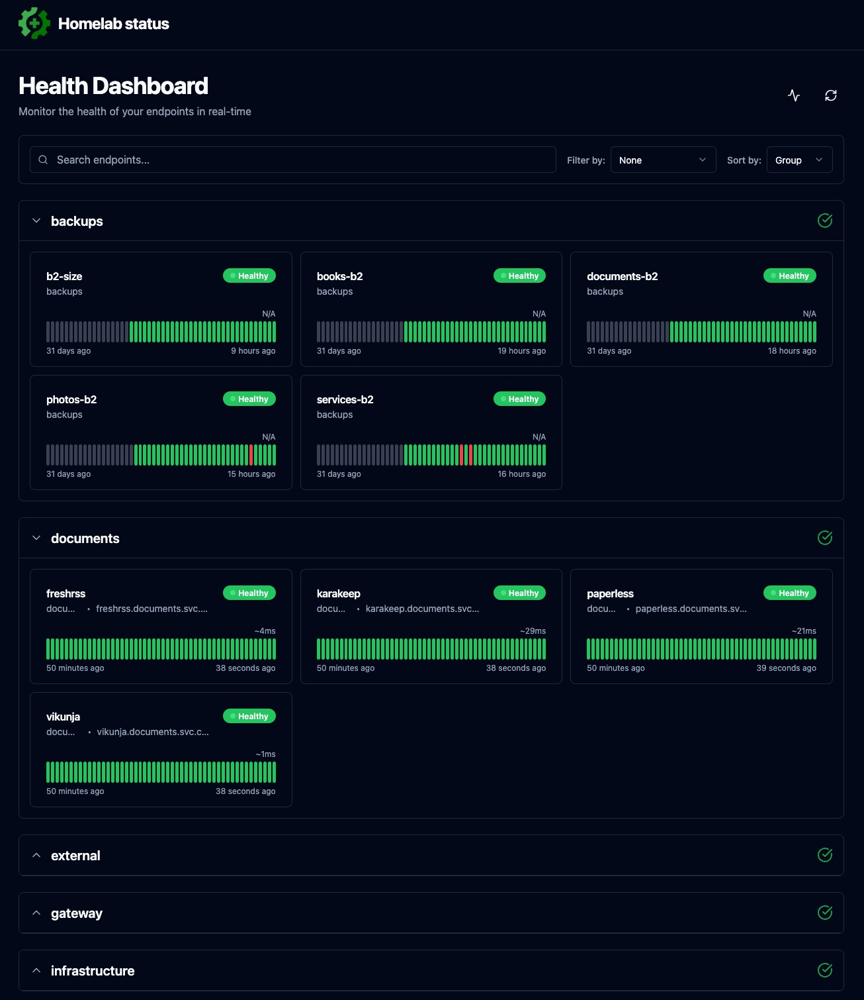

# My homelab and self-hosting setup

<figure markdown>
  [](https://unsplash.com/@kierinsightarchives)
  <figcaption>Cover photo by Kier in Sight Archives on Unsplash</figcaption>
</figure>


I've been running my homelab for quite some time, and I'm finally happy with it to the point where I'd like to share how it works and what problems it helps me solve.

This is an overview of my personal digital infrastructure setup and an attempt to organize my knowledge and experience in one place that can later be used by anyone building a homelab.

Whether you're a tech enthusiast like me or just want to swap some paid subscription-based services for self-hosted alternatives, I hope you can take something useful from this.

<!-- more -->


!!! tip
    I've created a [repository](https://github.com/dteslya/homelab-example) that you can refer to while reading this article.
    It is [built automatically](#the-example-repository) from the private repository I actually use.

## Why self-hosting?

Before I go into details about how things work, I'd like to talk about the reasoning behind self-hosting and what it brings to the table.

For me, the most valuable thing about self-hosting is taking ownership of my digital life.
Being aware of where my data is stored, whether and how it's backed up, and whether it's private became important at some point.
Moving critical services to self-hosted alternatives helped me regain control.

My family and I rely on the services I self-host daily.
Here are a few examples:

- Request a movie in [Seerr](https://seerr.dev/), then wait a few minutes before it's available in [Jellyfin](https://jellyfin.org/) on my TV in the desired quality with subtitles automatically downloaded.
- Watch a new episode of a TV show that was downloaded automatically last night when the episode aired.
- Quickly scan a paper document with [Quickscan](https://www.quickscanapp.com/) and save it to [Paperless](https://docs.paperless-ngx.com/), where it gets OCRed and categorized so I can easily search for it later if I need to.
- Just enjoy the peace of mind of knowing that all the family photos are safely backed up off-site.

!!! note
    It's worth noting that I didn't set the goal of going 100% self-hosted.
    I still use managed services where they're more suitable or in addition to the self-hosted solution.
    For example, I use iCloud as my primary storage and interface for my photos, but they're continuously replicated to Immich's external library and backed up to Backblaze.
    If iCloud goes down, I can still browse my photos and be sure that they're safe.

Aside from the practical aspect, there's great value in learning by running a homelab.
I try new tools and services and learn new practices and approaches in my lab.
I later apply some of that knowledge at my workplace.

## A brief history

My first home server was a regular PC in a tower case running Slackware Linux and serving MP3 files via a Samba share from my parents' apartment balcony.
That was in the early 2000s, sometime around 2003–2004, I think.
It was a fun and rewarding experience.

<figure markdown>
  
  <figcaption>My first home server</figcaption>
</figure>

I studied at university, had my first real job as a junior system administrator, and used my home computer and home server to learn about Linux and programming.
The internet wasn't so ubiquitous, and we had a thing called... well, *neighborhood LAN* would be the closest term I could come up with.
It was a grassroots intranet built by a small community of computer enthusiasts.
Such networks were quite popular in post-Soviet countries during the late 1990s and early 2000s.
We had an IRC server, a bunch of file servers, including mine, and a bunch of game servers.
Good old days.
Later, those LANs turned into small local ISPs selling high-speed internet access, and the value of locally hosted services decreased before disappearing completely.

Fast-forward 20 years: exhausted by subscription fatigue and growing [privacy concerns](https://www.privacyguides.org/en/basics/why-privacy-matters/), I turn my gaze to self-hosting again.

I was surprised by how things had changed and evolved since my early days of homelabbing.
There were numerous [self-hosted services](https://awesome-selfhosted.net/) targeted specifically at home lab enthusiasts, the [*arr stack](https://trash-guides.info/), and [Reddit](https://www.reddit.com/r/selfhosted/) [communities](https://www.reddit.com/r/homelab/).
It was too fun not to try it.

I started by building a small NAS server based on an ASRock J5040-ITX motherboard with a soldered Intel Celeron CPU, stuffed with whatever spare HDDs I could find around the house.
I even shucked an old WD My Book drive, which still serves me.

<figure markdown>
  
  <figcaption>J5040-ITX build</figcaption>
</figure>

Having the hardware, I installed TrueNAS, spun up Plex and qBittorrent jails, and was quite happy with the setup, as I didn't have to connect my laptop to the TV to watch a movie anymore.
Later, the *arr stack was introduced, and I thought that was peak.

## Design

As time went by and the multimedia services running on my home server became part of the whole family's daily life, I started to think about the proper design and maintenance of my setup.
Everything was configured manually, without any documentation or backups.
It was crying out for a major overhaul.

I started with a general idea of a separate compute platform and TrueNAS as its storage, all managed as code.
Over the course of implementing it, I settled on the following principles:

- **Pragmatism over purity.** Automate and self-host by default, but only when it makes sense.
- **Rebuildable from code.** Git describes the system, and manual steps are written down.
- **No circular dependencies.** The tools needed to recover the lab can't live only in the lab.
- **Back up what can't be replaced.** Personal photos and documents are protected, while downloadable media isn't.
- **Secure by default.** HTTPS where possible, encrypted keys and backups, and remote access only via VPN.

Here's an overview diagram of my setup.

<figure markdown>
  
  <figcaption>Homelab diagram</figcaption>
</figure>

Basically, my whole lab consists of just two servers: a mini PC at home and a VPS.
The mini PC runs the Kubernetes cluster and TrueNAS VM; the VPS runs a Headscale instance.
There is a small network infrastructure consisting of one 8-port switch and three Wi-Fi routers, two of which act as dumb access points.
My family's mobile devices run Tailscale for remote access to the services running in the lab.

## What I'm running

In the table below, you can find the applications I currently run and what each of them covers.

| Need | App | Replaces |
|---|---|---|
| Movies and TV | [Jellyfin](https://jellyfin.org/), [Seerr](https://seerr.dev/), the *arr stack | Manual downloads |
| Music | Jellyfin, [slskd](https://github.com/slskd/slskd/), [beets](https://beets.io/) | Manual downloads |
| Photos | iCloud -> [icloudpd](https://icloud-photos-downloader.github.io/icloud_photos_downloader/) -> [Immich](https://immich.app/) -> Backblaze B2 | iCloud as the only copy |
| Documents | [Paperless-ngx](https://docs.paperless-ngx.com/) | scattered PDFs |
| Bookmarks | [Karakeep](https://karakeep.com/) | Telegram Saved Messages |
| Books | [BookOrbit](https://bookorbit.app/) | scattered ePUBs and PDFs |
| PDF tools | [BentoPDF](https://www.bentopdf.com/) | online PDF sites |
| Passwords | [Vaultwarden](https://github.com/dani-garcia/vaultwarden) | Bitwarden |
| Budgeting | [Actual Budget](https://actualbudget.org/) | YNAB |

I use [Homepage](https://gethomepage.dev/) for quick access to the apps and homelab infrastructure.

<figure markdown>
  
  <figcaption>Homepage dashboard</figcaption>
</figure>

I like it for its minimalist design and YAML-based configuration.

## Hardware

<figure markdown>
  
  <figcaption>Homelab shelving in the living room</figcaption>
</figure>

### Compute

I use [Beelink SER8](https://www.bee-link.com/products/beelink-ser8-8845hs) as my only physical server (at least for now), with the following specs:

- [AMD Ryzen 8845HS](https://www.amd.com/en/products/processors/laptop/ryzen/8000-series/amd-ryzen-7-8845hs.html) CPU (3.8 GHz, 8 cores/16 threads)
- 32 GB DDR5 5600 MHz
- 1 TB SSD

It is small, silent, and powerful enough to run a bunch of VMs.
Exactly what I needed to sit quietly in my living room.

### Storage

For some time, I used my old NAS build based on an ASRock J5040-ITX in the Be Quiet! BG034 tower case because I couldn't find anything smaller in local stores.
Then I tried the Thermaltake Dividеr 200 ТG, which was still too big.
That was before I discovered external hard drive bays (direct-attached storage, or DAS).
Purchasing one allowed me to get rid of the bulky PC case and reinvent the whole storage setup as a TrueNAS VM with a USB connection passed through to the DAS box.

So, currently, I have a [Cenmate 3 Bay enclosure](https://www.amazon.com/dp/B0DD3H6ZVS) with a single 3 TB shucked WD Green drive.
The plan is to replace it with three bigger drives and put them in a RAIDZ1 eventually.

I'm also entertaining the idea of migrating TrueNAS back to dedicated hardware.
That would free 8 GB of precious RAM from the Beelink box and make the setup more resilient.
For that, I'm thinking about 3D-printing a small case for my old J5040-ITX board and connecting the DAS box to it.

For now, I'm mitigating the risk of disk failure with off-site backups to Backblaze B2 (more on that in the [Backups](#backups) section).

### Network

The core of my physical network is the [HPE Instant On 1830 8-port switch](https://www.amazon.com/dp/B09NLCNGC7).
It's a fanless gigabit switch with VLAN support and a nice web UI.
It can't be managed via API or SSH, unfortunately, but at least I can do config backups with Ansible.
For me, it was an acceptable trade-off considering the price.

The network has the following segments (VLANs):

- User network (same VLAN for wired and wireless clients for simplicity)
- Server VMs (currently unused)
- Kubernetes cluster
- Storage network
- Management network
- ISP

Inter-VLAN routing and filtering take place on the TP-Link AX23 running OpenWRT.
The other two Xiaomi routers also run OpenWRT with the sole purpose of extending the Wi-Fi coverage.
All of them are fully managed with Ansible.

### Power

All hardware except the Wi-Fi APs is powered by an [APC Back-UPS 750VA (BX750MI-GR)](https://www.se.com/eg/en/product/BX750MI-GR/apc-backups-750va-tower-230v-4x-cee-7-7-schuko-outlets-avr/), which is connected to the Beelink box via USB for monitoring with `apcupsd`.

```bash title="UPS status"
dteslya@ser8:~$ apcaccess status | grep -E 'LOADPCT|BCHARGE|TIMELEFT'
LOADPCT  : 12.0 Percent
BCHARGE  : 100.0 Percent
TIMELEFT : 40.6 Minutes
```

It's enough to survive most of the power cuts that we occasionally have here.
The only issue I have with this UPS is that the power sockets are too close to each other, and most of the connected devices are powered by adapters that don't fit.
I had to purchase extension cables to fix that issue.

??? info "Power extension cable"

    { loading=lazy width="300"}


## Platform

### Kubernetes

I use Kubernetes to run my services, which is probably overkill, especially considering that it runs on a single box.
My primary motivation here was studying Kubernetes itself.
That's why I decided to go with the full distribution instead of less resource-intensive options like [k3s](https://k3s.io/) or [KubeSolo](https://www.kubesolo.io/).

### Talos Linux

The cluster consists of one control plane node (2 vCPU, 4 GB) and two worker nodes (4 vCPU, 8 GB each) running [Talos Linux](https://www.siderolabs.com/talos-linux).
I liked the idea of an immutable, purpose-built distro that I could declaratively manage along with other core infrastructure components.

Talos VMs are running on an Ubuntu 24.04 host OS with Incus installed as a package.

### Incus

[Incus](https://linuxcontainers.org/incus/) is the orchestrator that manages the Talos and TrueNAS VMs.
It was one of the main discoveries I've made with this lab.
It's tiny, API-driven, and provides a cloud-like UX.
I've briefly tried Proxmox before, a go-to solution for many home labbers, but found it too convoluted and outdated in terms of UX.
I even considered a minimalist setup such as Ansible-managed libvirt, but stumbled upon Incus and never looked back.

!!! Info
    The only caveat I encountered with Incus was the need to convert Talos images before they could be used by Incus.
    There is a [script](https://github.com/dteslya/homelab-example/blob/main/scripts/import-talos-image.sh) that does that in the example GitHub repo.

### TrueNAS

As already mentioned, TrueNAS was a physical machine before and may become one later, but for now, it's a VM running on the same box as the Kubernetes cluster.
The main driver behind this decision was saving physical space in the living room.

TrueNAS exposes NFS and iSCSI to the cluster.
NFS is used for media storage and config PVCs, while iSCSI provides block storage for databases.
Most of the PVCs are created dynamically by the official [truenas-csi](https://github.com/truenas/truenas-csi) driver, while some are created statically by OpenTofu so TrueNAS CloudSync jobs can point to them reliably.

Monitoring and Tailscale stay on the local disk so they keep working when TrueNAS is down (see the [design principles](#design) section).

## The VPS

I rent a cheap VPS at Racknerd with the following specs:

- 2 vCPU
- 2 GB RAM
- 30 GB disk

Its main purpose is to run the [Headscale](https://headscale.net/) control server.
Running it outside the homelab achieves two objectives:

- the tailnet stays up if the homelab goes down or loses its internet connection,
- no need for inbound ports at home.

Since my requirements are quite basic and I don't need all the features Tailscale provides I decided to go with Headscale.
I still use Tailscale's public DERP relays, though, for better coverage and redundancy.

The VPS is fully configured with Ansible and can be rebuilt from code at any time.
It holds no state, so I don't back it up.

I also host the [Headplane](https://headplane.net/) web UI in the Kubernetes cluster for convenience.
It connects to the Headscale instance via API and stays off the internet.

## PikaPods

About 2 years ago, I was looking for a YNAB alternative.
Many people on Reddit were praising Actual Budget, and I decided to give it a try.
The problem was that I didn't have a VPS or a proper homelab at that time to host it.
So I went with [PikaPods](https://www.pikapods.com/), which was the recommended way of running the app on its official website.
The cost of running the Actual Budget instance was already way lower than a YNAB subscription, so I didn't hesitate much.

Later, when I set out to migrate my Bitwarden vault to self-hosted Vaultwarden, PikaPods was a natural choice.

I store my homelab's encryption keys, break-glass credentials, and OpenTofu state—in other words, the stuff that is necessary for the lab's recovery—in Vaultwarden, so I can't host it in the homelab itself (see [Design Principles](#design)).

Running critical services on PikaPods gives me a nice balance between being in control and not having to worry about availability.
Paying upstream developers (Actual, in my case) is also a nice touch.

## Git and automation

A Git monorepo is the heart of my homelab.
If something can be put in code, I do it unless it brings more complexity or the automation effort costs more than doing it by hand a few times.

For example, I don't try to automate the *arr stack settings, although there are Terraform modules for that.
First, I'm not sure they can cover every setting I need, and I'll still have to resort to manual configuration, losing the uniformity in my approach; second, those settings are configured once, and then I just back them up and can restore them later.

In the table below, I give a breakdown of the Git-based automation tools I use to manage my lab.

| Layer | Tool | Owns |
|---|---|---|
| VMs and cluster | [OpenTofu](https://opentofu.org/) + [Talos](https://www.siderolabs.com/) | Incus VMs, cluster bootstrap |
| Storage | OpenTofu | TrueNAS |
| Apps | [ArgoCD](https://argo-cd.readthedocs.io/en/stable/) ([app-of-apps](https://argo-cd.readthedocs.io/en/stable/operator-manual/cluster-bootstrapping/#app-of-apps-pattern-alternative)) | everything in the cluster |
| Network and VPS | [Ansible](https://docs.ansible.com/projects/ansible/latest/index.html) | OpenWrt routers, Headscale VPS |
| Secrets | [Sealed Secrets](https://github.com/bitnami/sealed-secrets), ansible-vault | encrypted values safe to commit |
| Updates | [Renovate](https://github.com/apps/renovate) | version PRs from a dashboard |

Most of the lab is bootstrapped with a couple of `tofu apply` commands: one for TrueNAS (though the API key needs to be created manually), another for the cluster.
When the cluster is up, ArgoCD is installed automatically to take it from there and sync the apps from Git.

<figure markdown>
  
  <figcaption>ArgoCD app-of-apps</figcaption>
</figure>

To add a new app to the cluster, I simply create a new directory with a bunch of YAML files that can be copied from another app and adapted.
ArgoCD picks it up from Git and does the rest.

Updates are managed by [Renovate](https://github.com/apps/renovate), which keeps an always-open issue in the lab's GitHub repo listing packages with pending updates.
I tick the boxes next to the packages I want to update, and Renovate creates a PR for me to review.
When a PR is merged, ArgoCD syncs the app to the new version.
This could be fully automated, but I like to stay aware of the changes.

Ansible is used for things outside the cluster: the VPS and the network devices.
Those are fully Ansible-managed, except for the switch, for which only config backups are automated.

## Single sign-on

When I went looking for an [SSO](https://en.wikipedia.org/wiki/Single_sign-on) solution for my homelab, I started with the usual suspects: Keycloak, Authentik, and Authelia.
Then I came across [Pocket ID](https://pocket-id.org/), and one detail caught my attention right away: it doesn't support passwords at all and relies on passkeys instead.
It's also clearly targeted at self-hosters, with just the essential features and a simple, friendly UI.
I gave it a try and haven't looked back since.

<figure markdown>
  
  <figcaption>Pocket ID clients</figcaption>
</figure>

Almost all the applications I run are configured with SSO that allows me to use a single ID when logging in to any of them.
Two major exceptions are Jellyfin and Seerr, both of which rely on Jellyfin local authentication.
The reason for that is that not all clients (if any) [support OIDC](https://github.com/orgs/jellyfin/discussions/16470).

## Remote access

Tailscale and my own domain name allow me to achieve seamless access to the homelab's services from any location.

I have a wildcard public DNS record that points to the internal IP of MetalLB and a Tailscale subnet router that exposes that IP to my tailnet.
So, for example, when I try to access `https://homepage.lab.mydomain`, it resolves to the internal IP (i.e., 10.x.x.x), and the traffic gets routed either locally if I'm at home or via the tailnet.

!!! warning
    Yes, I'm exposing my internal addressing this way, but the benefits far outweigh the risks.

## Backups

The data I back up can be split into 2 main categories:

1. Data that can't be re-downloaded from the internet (personal photos and documents)
1. Configs that can't be recreated from code

I probably should back up the code too, but I'm OK with having a GitHub repo and a local copy for now.

Below is a summary of my backup setup.

| Data | Source of truth | Copies |
|---|---|---|
| Photos | iCloud | TrueNAS → B2 |
| Documents | Paperless | export → B2, plus a browsable iCloud mirror |
| App configs, cluster keys | the apps | B2 |
| OpenTofu state | B2 | Vaultwarden |
| Media files | — | not backed up, on purpose |

All files in B2 buckets are encrypted.

I use static TrueNAS datasets for the data that needs to be backed up.
Each dataset has a Cloud Sync job configured in TrueNAS that encrypts and uploads the data to dedicated private B2 buckets every night.
Cloud Sync uses COPY mode (1), so if something is accidentally deleted at the source of truth, there's an off-site copy.
{ .annotate }

1. Files from the source are copied to the destination.
   If files with the same names are present on the destination, they are overwritten.

The backup encryption keys live in the password manager running on [PikaPods](#pikapods).
This solves the chicken-and-egg problem when you need to restore the whole lab.

!!! note
    I never had to do a full restore, though, so it can't be considered a true backup yet.
    But I tried selectively restoring my photos to the local machine, and it worked without issues.

My current B2 usage is ~600 GB.

## Monitoring

My go-to monitoring tool is [Gatus](https://gatus.io/).
It was another discovery I made while building this lab.
It gives me a quick answer to the question "Is it up?" and alerts me via email if something goes down.
Then I can use other monitoring tools to troubleshoot.

<figure markdown>
  
  <figcaption>Gatus dashboard</figcaption>
</figure>

Another great use for Gatus is backup heartbeats.
Each Cloud Sync backup job runs a post-script that [reports to Gatus](https://github.com/TwiN/gatus#external-endpoints) in case of success.
If a backup fails, Gatus misses the heartbeat and sends an alert.
This way, I'm always aware of my backup state.

VictoriaMetrics monitors resource usage and various metrics across the cluster and on OpenWrt routers, while Grafana is used for dashboards.
I tried the classic [kube-prometheus-stack](https://github.com/prometheus-community/helm-charts/tree/main/charts/kube-prometheus-stack) at first, but it consumed more resources than any other service in the lab, so I had to look for alternatives.

## Monthly costs

You can find the approximate monthly costs of the paid services I use with my homelab in the table below.

| Service | Price/month | Notes |
|---|---|---|
| Backblaze B2 | ~ $4 | with $6.95/TB/month and my ~600 GB usage |
| PikaPods (Actual Budget, Vaultwarden) | ~ $3.5 | I just add $10 every few months when my credit is low |
| Racknerd VPS | ~ $2 | $23.65/year 2 GB KVM VPS Special Deal |
| Domain name | ~ $1 | $11.86/year on Cloudflare |

## The example repository

When I first decided to make a post about my homelab, I thought that I would make my homelab repository public.
But the amount of sensitive stuff there put me off that idea.
Instead, I came up with an export script that sifts through the code, rewrites identifying values, and fails if anything leaks.
The result is the real configuration you can borrow ideas from.

It's regenerated on each commit to the main branch of my private homelab repo, so issues are welcome, but PRs can't be merged directly.

Link: [https://github.com/dteslya/homelab-example](https://github.com/dteslya/homelab-example)

## Final thoughts

Right now, I'm quite content with the state of my homelab and self-hosted services.
I don't plan to change much in the architecture and automation workflows.
Maybe I'll add or remove a few services.
At least for now.
I still need to work on the physical redundancy, though.
Running on a single old HDD and a single mini PC can only take you that far.

I hope this post will be helpful for both beginners and long-time homelab enthusiasts.
If you have questions or suggestions about what could be done better or differently, please leave a comment.

